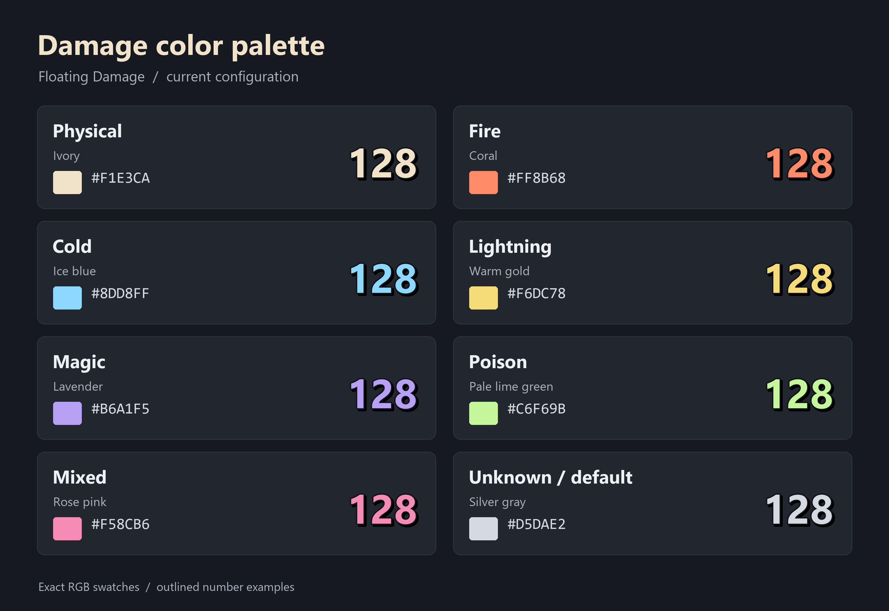

# Floating Damage

Version **1.3.1+rev.12** by PyreFly. A standalone D2RLoader client plugin
that displays floating numbers when nearby hostile enemies lose HP, regardless
of who dealt the damage. It includes killing blows, damage-type colors,
Critical/Deadly Strike emphasis, and configurable movement and visibility.

## Installation

Close D2R and D2RLoader. Extract the runtime ZIP into the game directory for
global use, or the active mod directory for mod-specific use. Its DLL installs
at `d2rloader/plugins/Floating Damage.dll`. Install in one active scope.

D2RLoader creates a missing `d2rloader/config/floating-damage.toml` from the
DLL's embedded defaults. `defaults/floating-damage.toml` is a reference: keep
your existing live config when updating. Restart through D2RLoader to apply
saved configuration changes or replace/remove the plugin. Native chat
registration retains the DLL until the game process exits.

Requires the exact loader-hosted D2R/D2RCore 1.3.1-beta profile in
[NATIVE-CONTRACT.md](../../NATIVE-CONTRACT.md). Artifact hashes and live native guards
must match; version labels alone are insufficient. Unsupported profiles leave
the feature unavailable with a log diagnostic. Validation targets local single
player. Remote multiplayer clients lack this reader's local authoritative game
state. Controller QOL is not required.

## Numbers and colors

Numbers show **HP actually lost**, rather than an attack's advertised damage
or overkill. A confirmed killing blow shows the last tracked HP remainder once.
Friendly/neutral alignments and disappearance without a confirmed death are
excluded. Positive amounts rounding below the selected precision display `<1`
or the corresponding decimal unit. Rapid observed decreases of at most 2 HP
can merge; set `tick_merge_ms = 0` for separate observations.

| Damage type | Default color | Hex |
|---|---|---|
| Physical | Ivory | `#F1E3CA` |
| Fire | Coral | `#FF8B68` |
| Cold | Ice blue | `#8DD8FF` |
| Lightning | Warm gold | `#F6DC78` |
| Magic | Lavender | `#B6A1F5` |
| Poison | Pale lime green | `#C6F69B` |
| Mixed | Rose pink | `#F58CB6` |
| Unknown/default | Silver gray | `#D5DAE2` |

Verified native components and exact HP endpoint coverage determine color.
Several matched components use the mixed color. Unmatched/ambiguous decreases
use `text_color`; `element_colors = false` uses that color for all numbers.
Poison ticks require matching guarded rate/frame/expiration evidence.

Native Critical and Deadly Strike share one marker. Matched numbers retain
their damage color and use the selected critical style: suffix, larger text,
or both. The default remains 35% larger with `!!`. The plugin does not
guess critical hits from damage size, identify which of the two mechanisms
triggered, or multiply the displayed HP loss. Fresh poison-only groups do not
inherit an earlier weapon hit's critical emphasis.



## Styling

Edit `[floating-damage]` in the live TOML, then restart. The reference file
lists all settings. Important defaults include:

```toml
text_size = 26
resolution_scaling = true
critical_hits = true
critical_style = "both"
critical_size_scale = 1.35
lifetime_ms = 1000
falling_motion = true
rise_pixels = 64
side_pixels = 48
fall_pixels = 96
outline_color = "#101215"
outline_width = 2
shadow = true
shadow_color = "#000000"
shadow_opacity = 0.75
backing = true
backing_poison_only = true
backing_color = "#0A0D10"
backing_opacity = 0.68
fade_start = 0.8
debug = false
```

`text_size` accepts 12–64 base pixels at **1920 × 1080**. With
`resolution_scaling = true`, the plugin applies one uniform factor:
`min(screenWidth / 1920, screenHeight / 1080)`. A 3840 × 2160 overlay viewport uses
2×; 2560 × 1440 uses 4/3×. For example, the default size 26 draws at 52 pixels
in 4K and about 34.7 pixels in 1440p. The factor is bounded to 0.25–4;
invalid screen dimensions use 1×.

Font size, number offsets, lane spacing, motion distances, outline, shadow and
backing geometry scale together. Projected target positions remain the anchor.
Animation lifetime, fade timing, opacity, HP amounts and grouping do not change.
Set `resolution_scaling = false` to keep fixed screen pixels at every resolution.

Choose the presentation for matched critical hits with `critical_style`:

| Value | Example | Size relative to an ordinary number |
| --- | --- | --- |
| `"suffix"` | `64!!` | Normal size |
| `"size"` | `64` | Multiplied by `critical_size_scale` |
| `"both"` | `64!!` | Multiplied by `critical_size_scale` |

`critical_size_scale` accepts 1–2, defaults to 1.35, and affects `"size"` and
`"both"` only. A value of 1 keeps the normal size. Resolution scaling applies
to all three styles. `critical_hits = false` disables both emphasis effects.

Older configs that omit the new keys use `resolution_scaling = true` and
`critical_style = "both"`. Existing saved values are preserved; extraction does
not replace the live TOML. To retain the earlier fixed-pixel appearance, add
`resolution_scaling = false`. Restart to apply saved configuration changes.

Colors accept quoted `#RRGGBB`; legacy RGB arrays remain supported. Outline width
is 0–3 base pixels.
Shadow offsets, softness, opacity and backing padding/radius are configurable.
Poison backing also applies to mixed numbers containing poison; set
`backing_poison_only = false` for backing on every number.

Rise/fall motion reaches its peak at 42% of the lifetime and drifts to
alternating sides. Set `falling_motion = false` for a straight rise. Changing
`lifetime_ms` adjusts the whole animation. Numbers follow their target; all
layers fade together during the final 20% by default.

## Chat commands

| Command | Effect |
|---|---|
| `/damagenumbers` | Toggle the feature |
| `/damagenumbers on`, `off`, `status` | Select or report enabled state |
| `/damagenumbers motion` | Toggle rise/fall versus straight rise |
| `/damagenumbers motion on`, `off`, `status` | Select or report motion |
| `/damagenumbers capture on`, `off`, `status` | Bounded diagnostic capture |

Commands are local; feedback appears in D2RLoader's console. The console also
accepts `damagenumbers` without `/`. Runtime toggles do not rewrite the TOML.
Turning numbers off clears their tracking; enabling starts fresh baselines.
Capture defaults off, stops at 128 records or game exit, and adds no screen text.

## Validation and limits

Beta.12's MSVC Release build with `/W4 /WX` and all seven automated suites pass.
Coverage includes viewport/mode/config controls, production drawing-adapter
checks at 2× scale with dense outline, shadow and backing, HP/death modeling,
guarded readers, element/poison/critical correlation, native chat lifetime and
exact-DLL ABI/defaults/exports/file-version checks. These tests are separate
from visible gameplay validation.

Live testing established ordinary/killing numbers, projection, motion/chat
toggles, fire/cold/lightning/magic/poison colors, surviving and killing poison
ticks, mixed-to-poison transitions, and shared native critical-marker controls.
Beta.12 resolution scaling at 4K and the three critical-style modes still need
live visual checks. Enlarged critical rendering, dense-combat performance, poison
expiration on a surviving target and broader camera/resolution/session coverage
also remain pending. Multiple unseen changes can merge or net healing can obscure
damage. Missing evidence declines classification rather than borrowing a nearby
hit's element. No attacker identification, DPS meter or live config reload is
provided.

Reported Unique-browser crashes have a recurring native pointer-read signature
that predates critical styling. Their underlying cause is unproven; this release
does not claim a crash fix or immunity from cross-plugin interactions.

Copyright and usage terms are in the project `LICENSE`; the packaged SDK license
applies to its components. No game binaries, loose native sprites, logs or
private capture artifacts are included in the runtime ZIP.

## Building from source

Initialize the repository SDK submodule. In an MSVC x64 Developer Prompt:

```powershell
cmake -S plugins/floating-damage -B build/floating-damage -A x64
cmake --build build/floating-damage --config Release
ctest --test-dir build/floating-damage -C Release --output-on-failure
```

The source includes the user-owned native-chat/image-reader subset with
provenance in `vendor/README.md`. Test fixture DLLs are build-only and must not
be installed. Native evidence is recorded in the repository's
`docs/reverse-engineering/floating-damage-*.md` records.
The [viewport scaling and native font-size record](../../../../docs/reverse-engineering/floating-damage-resolution-scaling.md)
documents the SDK coordinate space, static Core forwarding/bounds and remaining
live-resolution limits.
